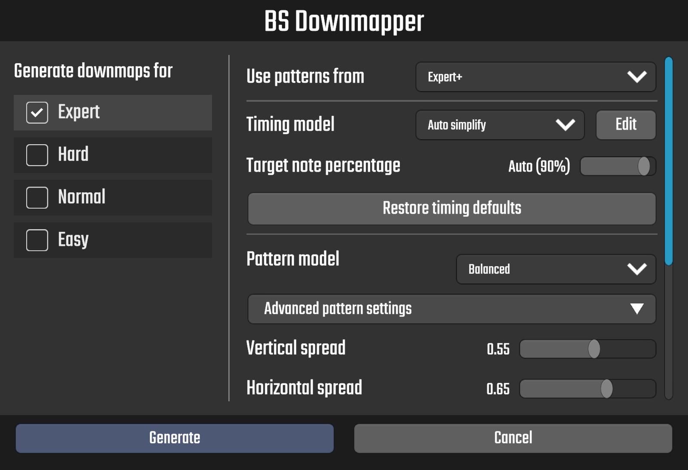
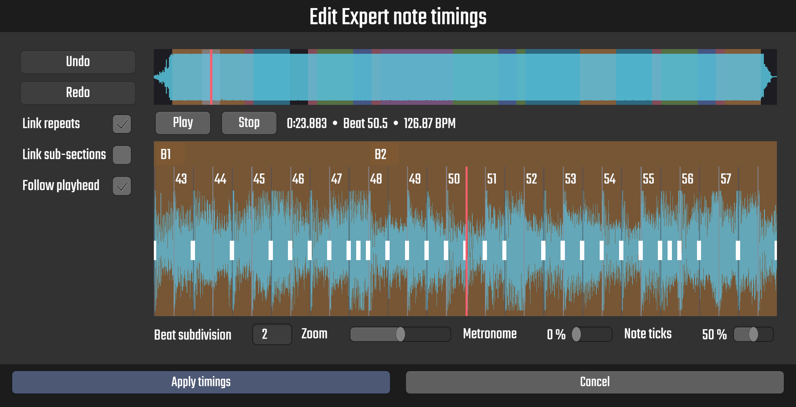

#  BS Downmapper

Generate lower Standard difficulties for Beat Saber from a saved chart. The ChroMapper plugin lets you preview and edit the proposed rhythm before applying the pattern and flow pass. All timing models run locally. See the [Linux x64 build instructions](plugins/chromapper/README.md#build-for-linux-x64) for native Linux ChroMapper.

## Download

Close ChroMapper, remove any previous BS Downmapper DLL from its `Plugins` folder, and copy the DLL for your platform into that folder. Then restart ChroMapper.

## Screenshots

**Main window** — choose target difficulties, timing, and pattern settings.

**Edit timings** — preview and adjust note timings against the song waveform.

## Start here

- [Install and use the ChroMapper plugin](plugins/chromapper/README.md)
- [How downmapping works](docs/pipeline.md)
- [Mapping mechanics and review guide](docs/mapping-guide.md)
- [Test timing compliance and train models](docs/evaluation.md)
- [Contribute and build a release](docs/contributing.md)
- [Release checklist](docs/release-checklist.md)
- [Third-party notices](THIRD-PARTY-NOTICES.md)
- [Test map catalog](maps/test-candidates.json)

## Get better downmaps

The less the downmapper has to invent, the better. Start with a hand-mapped **Standard Expert** when you have one. It gives the lower difficulties a rhythm and patterns that have already been simplified by a mapper.

1. Save your Expert chart. In BS Downmapper, check **Hard**, **Normal**, and **Easy**, or whichever lower difficulties you need. For each target, set **Use patterns from** to **Expert**. To prune Expert's rhythm, select **Auto simplify** under **Timing model**, then choose **Expert** as the **Starting chart** in **Timing settings**. If you've already authored the target's rhythm, select that saved difficulty under **Timing model**.
2. Review the highest selected downmap first, usually Hard. Click **Edit**, listen through the proposal, and use **Apply timings** to save your edits for the batch. If you remove an entire timing from Hard, the lower selected difficulties inherit that removal. Restoring a timing makes it available again, but each lower difficulty can still prune it.
3. Review Normal and Easy where needed, then click **Generate**. The batch works from highest to lowest. If a lower difficulty you left unchecked already uses a timing you removed, generation flags the conflict before saving. Include that difficulty in the batch if you want it regenerated.
4. Open and playtest each result. Check that the patterns flow at the intended difficulty, especially around fast transitions, crossovers, walls, bombs, and section changes. Adjust any patterns that feel awkward or obscure the rhythm.

## License

[MIT](LICENSE), Copyright (c) 2026 Skyler. Bundled dependencies retain their own licenses; see [third-party notices](THIRD-PARTY-NOTICES.md).
